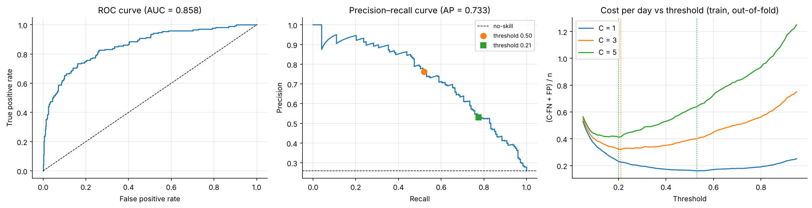
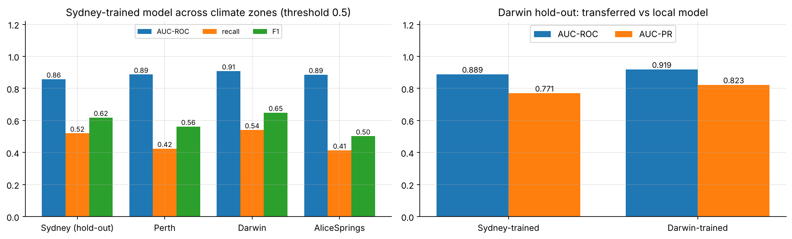
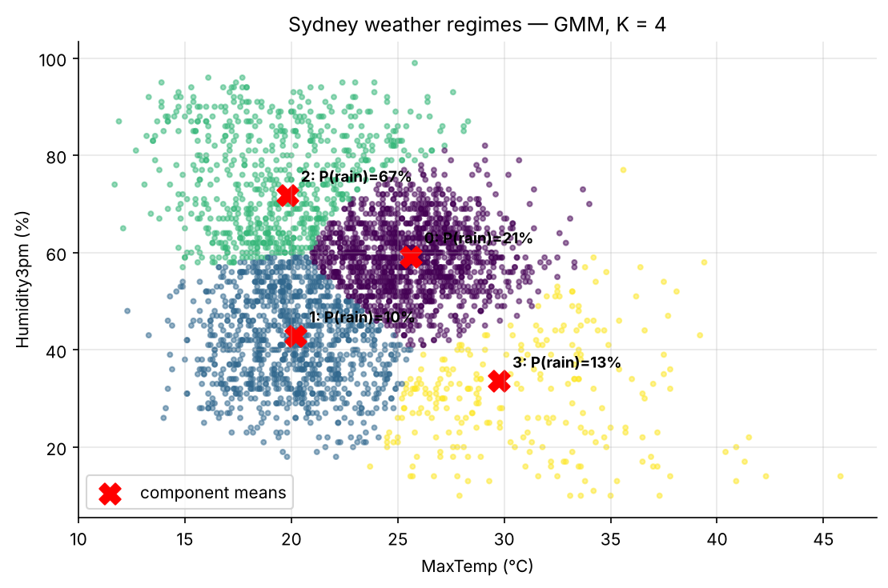
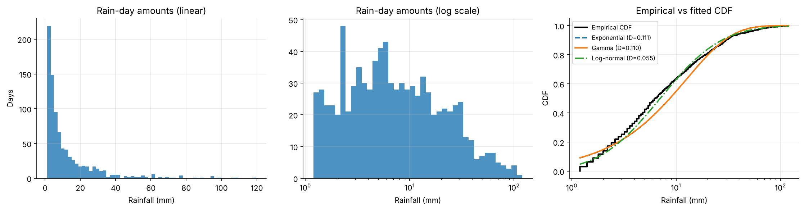

# Rainfall in Australia: Statistical Modelling & Next-Day Rain Prediction

End-to-end statistical analysis of ~10 years of daily weather data from the Australian Bureau of Meteorology:
distribution fitting, Bayesian inference, regression, classification with cost-sensitive thresholds, clustering,
Monte Carlo simulation, time-series forecasting, and a test of how well a model trained in one climate transfers to others.

*MSc Machine Learning, University of Thessaly · Mathematical Modelling II, 2025–26*

**Stack:** Python · pandas · NumPy · SciPy · scikit-learn · statsmodels · Matplotlib

---

## Key results

| Question | Answer |
|---|---|
| How well can tomorrow's rain be predicted from today's weather (Sydney)? | L2 logistic regression: **AUC-ROC 0.86, AUC-PR 0.73** (no-skill baseline 0.26) |
| What decision threshold should a user act on? | It depends on what each error costs. If a missed rain day costs 3× a false alarm, the optimal threshold is **0.21, not 0.5**. Recall rises from 52% to 77% and total cost falls by 15% on the hold-out set. |
| Does a Sydney model work in other climates? | Its **ranking transfers** (AUC 0.89–0.91 in Darwin, Perth and Alice Springs), but its **calibration does not**: recall falls to 41–42% at Perth and Alice Springs. A Darwin-trained model raises F1 on Darwin from 0.64 to 0.74. |
| What is the chance a rain day exceeds 50 mm? | Gamma model 3.8% (confirmed by Monte Carlo), empirical 4.2%. The real tail is heavier than the Gamma; extremes need extreme-value methods. |
| Are there distinct weather regimes? | A GMM finds 4 regimes. In the "cool-wet" one, **rain follows 67% of the time**; in "cool-dry", 10%. |

## Highlights

**Cost-sensitive threshold selection.** The threshold is chosen on out-of-fold training predictions and checked once on the test set.



**Generalisation across climate zones.** AUC holds up, but recall and F1 drop, and a local model is clearly better.



**Weather regimes found without labels** (Gaussian mixture on MaxTemp × afternoon humidity)



**Rain-day amounts and distribution fits**



## What's inside

| # | Task | Methods |
|---|------|---------|
| 1 | Exploratory analysis & seasonality | descriptive stats; Exponential / Gamma / Log-normal fits; Kolmogorov–Smirnov |
| 2 | Rain-day amounts as Gamma(α, β) | method of moments; **numerical MLE via Newton's method on the digamma equation**; AIC |
| 3 | Probability of a rain day | Bayesian Beta–Bernoulli update vs. MLE and Wald interval |
| 4 | MaxTemp regression | OLS from the normal equations; residual diagnostics; Breusch–Pagan |
| 5 | Next-day rain classifier | leakage-safe sklearn `Pipeline` (impute → scale → one-hot); L2 logistic regression; stratified 5-fold CV |
| 6 | Evaluation & decision threshold | ROC/PR curves; cost-weighted threshold sweep for C ∈ {1, 3, 5} |
| 7 | Model selection | AIC vs. BIC for nested logistic models (statsmodels) |
| 8 | Weather regimes | Gaussian mixture (EM), BIC model selection, adjusted Rand index |
| 9 | Extreme rainfall | analytic Gamma tail vs. Monte Carlo (with standard error) vs. empirical |
| 10 | Time series | ADF, ACF/PACF, daily ARIMA vs. monthly seasonal SARIMA, compared with naive baselines |
| 11 | Transfer across climates | Sydney model on Darwin / Perth / Alice Springs; retraining a local model |

Each task in the notebook includes the derivation, the code, and an interpretation of the results in meteorological terms.

## Findings worth discussing

* **AIC needs maximum-likelihood fits.** With method-of-moments estimates the Gamma looks *worse* than the Exponential (ΔAIC = +120). That is impossible for nested models at their MLEs. The numerical MLE fixes it, and modelling the excess over the 1 mm rain-day threshold shows the Gamma clearly wins (α̂ = 0.73, ΔAIC = −60).
* **Data hygiene.** The raw `RISK_MM` column is tomorrow's rainfall, so it would leak the target and is dropped. `Yes/No` labels are mapped so that missing values stay missing instead of silently becoming "no rain". Missing calendar days in the time series are kept as missing, not filled with 0 mm.
* **Honest baselines.** The daily ARIMA barely beats a constant mean (MAE 7.17 vs 7.25 mm), and its 95% intervals include negative rainfall. Monthly SARIMA beats seasonal-naive and climatology forecasts (MAE 2.48 vs 2.83 / 2.80 rain days per month).
* **The hypothesis in the brief was refuted.** The brief expected AUC to drop by 0.10–0.20 outside Sydney. It did not. What breaks under climate shift is the decision threshold and calibration, which points to per-station recalibration or per-zone models.

## How to run

```bash
git clone https://github.com/ststamatis-art/australian-rainfall-analysis.git
cd australian-rainfall-analysis
pip install -r requirements.txt
jupyter notebook notebooks/rainfall_analysis.ipynb
```

The notebook downloads `weatherAUS.csv` into `data/` on first run (from a public GitHub mirror of the
[Kaggle dataset](https://www.kaggle.com/datasets/jsphyg/weather-dataset-rattle-package)). To use your own copy from Kaggle,
place it at `data/weatherAUS.csv`. Results are reproducible with `SEED = 42`. A full run takes under a minute.

## Repository structure

```
├── notebooks/
│   └── rainfall_analysis.ipynb   # full analysis with outputs
├── figures/                      # figures exported by the notebook
├── data/                         # dataset is downloaded here (git-ignored)
├── requirements.txt
└── README.md
```

## Data

Rain in Australia, Australian Bureau of Meteorology, via Kaggle: 49 stations, 2008–2017, 23 daily variables
(temperature, rainfall, evaporation, sunshine, wind, humidity, pressure, cloud cover, RainToday/RainTomorrow).
